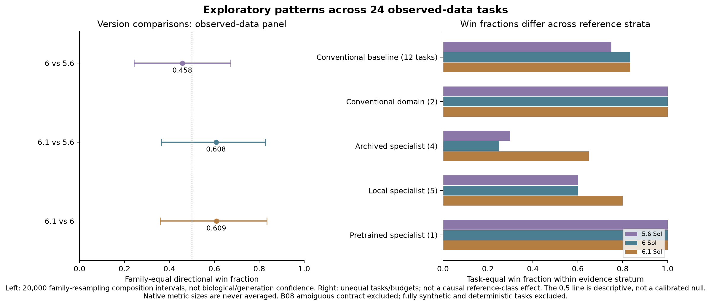

# Macro patterns in Neural Data Bench

Retrospective analysis revision 2026-10-31-v12. **No new benchmark or model run.** Measurement snapshot 0.11: 30 tasks across 14 families, 37 slices/model, 111 model attempts and 208 model/reference rows. The [quick audit](../quick-audit-v12.json) checks all 200 successful records and preserves eight original failed rows (four model failures, four archived-reference failures).

There are useful descriptive signals, especially a GPT-6.1 directional advantage and metric/source-shift reversals. This panel establishes no universal improvement law, no reliable causal predictor of generalist success, and no general-model victory over current strongest specialists. Failure to reject the family-level null does not show that all variation is noise.

## How the analysis is organized

The requested buckets are **quantitative**, **qualitative**, and **quantitative + qualitative**. Each finding below distinguishes a panel fact, an assumption-dependent statistical diagnostic and an interpretation. This is a retrospective synthesis, not a preregistered discovery study. Public labels, convenience selection, shared sources and one generation per task limit inference. [Methods](methods.md), [machine-readable statistics](statistics.json), [task context](task-context.csv), [native paired margins](paired-slices.csv).

The left intervals resample the 13 benchmark families 20,000 times. They describe benchmark-composition sensitivity, not biological or code-generation confidence. The 0.5 line is a descriptive reference; ties and failures prevent treating it as a calibrated null. Reference strata on the right contain different tasks and unequal budgets; their differences are not causal.

## Quantitative findings

### Q1. GPT-6.1 has a directional advantage on this panel, with substantial uncertainty

**Descriptive signal; general superiority unestablished.** Against GPT-6: 23 wins, seven losses and one failed comparison across 31 slices from 24 tasks in 13 families. Family-equal win fraction 0.6090; task-equal fraction 0.6875. Penalizing the newer-only failure gives signed family contrast 0.2179. Exact conditional sign-flip p=0.4463; Holm-adjusted p=1.0000. Neither significance nor no-effect is established.

### Q2. The version sequence is not a monotonic improvement law

**Exact panel description.** Among 30 slices where all three models produced numerical scores, only nine improve monotonically (allowing a numerical tie), and six of 23 complete tasks do so on every slice. GPT-6.1 is best or numerically tied-best on 20 slices but worse than both older models on five. Missing J08 is excluded from these complete-case counts. Version names do not provide compute, parameter-count or training-data measurements.

### Q3. Reference strata produce different apparent win rates

**Descriptive; confounded by task and reference selection.** Task-equal point-win fractions against conventional baselines are 0.7500 / 0.8333 / 0.8333 for 5.6 / 6 / 6.1 (12 tasks). Against archived specialists they are 0.3000 / 0.2500 / 0.6500 (four tasks); local specialists give 0.6000 / 0.6000 / 0.8000 (five tasks). These are different task sets, with unequal inputs and optimization histories. This is not a causal effect of specialist status, and GPT-6.1’s local-specialist rate is close to its conventional-baseline rate.

### Q4. Cell and molecular tasks show the most consistent multi-task category signal

**Retrospective category observation; hypothesis for replication.** GPT-6.1 beats both older versions on all four measured cell/molecular tasks: K01 morphology classification, K04 cortical-layer transfer, K05 marker-fraction calibration and K06 PV/SST waveform classification. These four are strict-format common support. This is the largest category with an all-task directional advantage for GPT-6.1 in the observed panel. It does not establish a modality law: broad source collections overlap, tasks were selected for feasibility, and K01 has a small native margin. SingleR still beats GPT-6.1 on K04 (0.5546 vs 0.5506). No category-specific significance claim is made after inspecting all categories.

### Model-version diagnostics

| Contrast | Wins | Losses | Ties | Missing/failed | Task-equal wins | Family-equal wins | Conservative signed contrast | Conditional p | Holm p (3) |
| --- | --- | --- | --- | --- | --- | --- | --- | --- | --- |
| 5.6 Sol → 6 Sol | 14 | 16 | 1 | 0 | 0.4750 | 0.4577 | -0.0654 | 0.8086 | 1.0000 |
| 5.6 Sol → 6.1 Sol | 22 | 8 | 0 | 1 | 0.7069 | 0.6077 | 0.2154 | 0.4155 | 1.0000 |
| 6 Sol → 6.1 Sol | 23 | 7 | 0 | 1 | 0.6875 | 0.6090 | 0.2179 | 0.4463 | 1.0000 |

The signed contrast averages +1 for a newer win and −1 for a newer loss within task, then within family, then equally across families. A newer-only numerical failure counts as −1; an older-only failure +1; both failed zero. No numerical score is invented. Sign-flip p-values enumerate all 8,192 family sign patterns under an assumed symmetric independent-family null. The taxonomy and observations do not establish that assumption. The three main contrasts receive Holm adjustment; other analyses are sensitivities, not additional confirmatory discoveries. All adjusted p-values are 1.0.

### Sensitivity to inclusion and compliance

| Contrast | Scope / policy | Tasks | Families | Slices | Family-equal wins |
| --- | --- | --- | --- | --- | --- |
| 5.6 Sol → 6 Sol | Observed, all attempted | 24 | 13 | 31 | 0.4577 |
| 5.6 Sol → 6 Sol | Observed, pair complete cases | 24 | 13 | 31 | 0.4577 |
| 5.6 Sol → 6 Sol | Observed, pair strict | 21 | 13 | 24 | 0.4487 |
| 5.6 Sol → 6 Sol | Synthetic-inclusive | 27 | 13 | 34 | 0.4321 |
| 5.6 Sol → 6 Sol | Common all-three strict complete support | 20 | 12 | 23 | 0.4861 |
| 5.6 Sol → 6.1 Sol | Observed, all attempted | 24 | 13 | 31 | 0.6077 |
| 5.6 Sol → 6.1 Sol | Observed, pair complete cases | 23 | 12 | 30 | 0.6583 |
| 5.6 Sol → 6.1 Sol | Observed, pair strict | 21 | 13 | 24 | 0.6218 |
| 5.6 Sol → 6.1 Sol | Synthetic-inclusive | 27 | 13 | 34 | 0.6077 |
| 5.6 Sol → 6.1 Sol | Common all-three strict complete support | 20 | 12 | 23 | 0.6736 |
| 6 Sol → 6.1 Sol | Observed, all attempted | 24 | 13 | 31 | 0.6090 |
| 6 Sol → 6.1 Sol | Observed, pair complete cases | 23 | 12 | 30 | 0.6597 |
| 6 Sol → 6.1 Sol | Observed, pair strict | 24 | 13 | 31 | 0.6090 |
| 6 Sol → 6.1 Sol | Synthetic-inclusive | 27 | 13 | 34 | 0.6090 |
| 6 Sol → 6.1 Sol | Common all-three strict complete support | 20 | 12 | 23 | 0.6597 |

Common-support strict results use the same 20 tasks / 12 families / 23 slices for every pair. Pair-specific strict results use different panels; they must not be directly ranked as if only compliance changed. Complete-case exclusion removes the sole family-J task for comparisons involving GPT-6.1, explaining part of its higher fraction. Synthetic-inclusive summaries still exclude M04, N05 and ambiguous B08.

For 6.1 versus 6, omitting any one family leaves the family-equal win fraction between 0.5764 and 0.6597. The family-composition interval is [0.3590, 0.8333]. The conservative signed contrast also stays positive under every single-family omission. This direction is not caused by only one category, but simultaneous family changes and unmeasured generation/source uncertainty remain substantial. The historical missing-as-neutral diagnostic yields p=0.2617, adjusted 0.7031; it also supplies no rejection.

### Reference evidence strata

| Declared class | Tasks | Slices | 5.6 win fraction | 6 win fraction | 6.1 win fraction |
| --- | --- | --- | --- | --- | --- |
| conventional baseline | 12 | 14 | 0.7500 | 0.8333 | 0.8333 |
| conventional domain reference | 2 | 3 | 1.0000 | 1.0000 | 1.0000 |
| historical specialist | 4 | 8 | 0.3000 | 0.2500 | 0.6500 |
| local specialist | 5 | 5 | 0.6000 | 0.6000 | 0.8000 |
| pretrained specialist | 1 | 1 | 1.0000 | 1.0000 | 1.0000 |

Slices are averaged within task. Strict variants and family-weighted values are in statistics.json. The [complete category scan](category-signals.csv) reports every family and all three contrasts, including negative and neutral task counts; Q4 is not an independently selected confirmatory hypothesis. The pretrained stratum contains only Sleep-EDF/YASA; it cannot establish a class-wide pattern. C05 uses a test-selected historical envelope; H01 permits explicit post-hoc alignment; local OASIS is not strongest CASCADE; other baseline/local/historical optimization histories vary. None certifies current global SOTA.

## Qualitative findings

### L1. The tested capability is building analysis procedures

**Scope interpretation.** All three Sol models generate numerical programs that are then fitted locally. Their wins support trying a generated algorithm baseline on a well-defined numeric endpoint. They do not establish native raw neural-data perception, general multimodal/world-model skill, autonomous experiment execution or specialist-tool-agent performance.

### L2. A benchmark name does not specify the information contract

**Protocol interpretation.** Custom slices provide processed waveforms, calcium traces, pose features, expression columns, known simulator equations or small storage chunks. Supervised K05 fraction calibration differs from reference-only deconvolution; likelihood-informed L06 differs from simulator-only inference; E06 uses a subset and locally optimized NLinear. Those distinctions can explain what is feasible, but this panel cannot estimate their causal effect.

### L3. Biological replication remains the main evidence gap

**Unmeasured uncertainty.** Examples include one held-out bird in A15, two test fish in C06, one brain/session in E06 and one monkey shared by G01/B08. Many cells, frames or windows do not create independent cohorts. Most tasks have one code generation. Category resampling cannot recover missing animal, lab, generation or prompt uncertainty.

## Quantitative + qualitative findings

### C1. Metric choice can reverse which model looks better

**Quantitative case evidence plus scientific interpretation.** C06 GPT-6.1 has higher correlation than GPT-5.6 (0.8676 vs 0.8564), but worse relative count error (3.2471 vs 1.9040). In B01, GPT-6 exceeds GPT-5.6 on the frozen unit metric (0.9400 vs 0.8750), but falls below it on post-hoc all-output event F1 (0.5998 vs 0.9000). Two of three B01 pairwise model orderings reverse. Calibration and extra events affect scientific use; a single primary leaderboard value cannot establish those properties.

### C2. Within-condition improvement does not guarantee transfer

**One controlled source-shift case; hypothesis for replication.** On E06, GPT-6.1 reduces MSE versus GPT-6 by 16.6% on temporal tails, but increases it by 8.5% on the prespecified unseen-taxis slice. The same programs, training arrays, neurons and brain are used; native target distributions differ. This is a real ordering reversal, not proof of a universal transfer law or a causal mechanism.

### C3. Failure definitions and reproducibility matter to the conclusion

**Direct procedural evidence.** The panel has 107 numerical successes in 111 model attempts, but only 100 meet the line-format criterion as well. Two B08 failures arise from ambiguous utility-import wording and stay visible while the task is excluded from aggregate claims. J08’s GPT-6.1 numerical failure remains a loss in the conservative diagnostic. H02’s three attempts per model are separate evidence on one source, not extra independent tasks.

### Calcium calibration: native numbers

| Procedure | Fish-equal Pearson ↑ | Relative count error ↓ | Signed relative count bias |
| --- | --- | --- | --- |
| 5.6 Sol | 0.8564 | 1.9040 | 1.0764 |
| 6 Sol | 0.8466 | 3.9636 | 3.4873 |
| 6.1 Sol | 0.8676 | 3.2471 | 2.8173 |
| task-baseline | 0.7155 | 25.0786 | 24.2839 |

The paired-*.csv exports explicitly label the historical missing-as-neutral descriptive policy. Main diagnostic rows are in [main-conservative-slices.csv](main-conservative-slices.csv), [main-conservative-tasks.csv](main-conservative-tasks.csv) and [main-conservative-families.csv](main-conservative-families.csv).

Relative count error is absolute predicted-versus-true total-count difference divided by true count, averaged equally over neurons within fish and then over fish. It is a ratio, not percentage points or per-bin error; 1.9040 is about 190.4% relative error. Signed bias is separately averaged, so cancellation is possible. Both are predeclared secondary diagnostics; Pearson remains the primary. B01 event F1 is post-hoc and never replaces its frozen primary.

## What is not established, and what to do next

No scaling law is fitted: three model labels do not provide model size, compute or training-data quantities, and progress is not monotonic. No task-difficulty or modality success predictor is fitted: 24 heterogeneous task endpoints, confounded references and few independent sources cannot support a stable moderator model. Non-rejection is not equivalence and does not prove noise. Native deltas remain in their units; tiny point wins have no retrospectively invented practical-equivalence threshold.

For a lab, the evidence supports generating a cheap baseline when the numeric interface and validation contract are explicit, then checking the property the science needs: calibration, extra events, unseen-condition transfer or exact reconstruction. Keep the strongest feasible matched specialist and inspect saved outputs. This is a practical interpretation, not a tested cost-effectiveness or deployment recommendation.

The most informative next experiment is a fixed diverse panel with repeated generations and independently held-out sources, a priori meaningful endpoint margins and strong specialists with matched inputs and tuning budgets. Replicate the C06 calibration and E06 shift reversals on new sources. Keep H02 repetitions separate until other tasks have comparable generation depth.

## Traceability and research basis

- [Statistical procedure and assumptions](methods.md); [all task context and limits](task-context.csv); [independent review](independent-review.md).
- [Pair slices and native margins](paired-slices.csv), [task summaries](paired-tasks.csv), [family summaries](paired-families.csv), [reference comparisons](reference-slices.csv), [three-model ranks](three-model-ranks.csv), [monotonicity rows](monotonic-slices.csv).
- Original [central ledger](../../results/measurements.jsonl), [protocols](../../experiments), [macro policy](../../docs/macro-analysis-plan.md).
- Demšar (2006), [Statistical Comparisons of Classifiers over Multiple Data Sets](https://jmlr.org/papers/v7/demsar06a.html), motivates comparing dimensionless ranks across datasets rather than mixing arbitrary native metrics. This report uses a separately specified family sign-flip diagnostic because task families and shared slices require explicit grouping; it does not claim to implement all of that paper’s procedure.
- Agarwal et al. (2021), [Deep Reinforcement Learning at the Edge of the Statistical Precipice](https://proceedings.neurips.cc/paper_files/paper/2021/hash/f514cec81cb148559cf475e7426eed5e-Abstract.html), motivates uncertainty-aware benchmark reporting. Its repeated-run inference is not available from our mostly single-generation panel; family-composition resampling is labeled accordingly.
