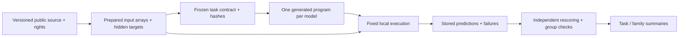

# Evaluation methodology

## Scientific question and estimand

We measure a **specified model plus a specified procedure**, conditional on an exact task, dataset, split, permitted information and execution budget. The current experiments evaluate **T3: generated analysis code followed by local fitting/prediction**. They do not directly measure pretrained signal embeddings, a model interpreting a raw recording without numerical tools, or a complete autonomous neuroscience workflow. Current counts and failures are generated from [the central store](../analysis/summary.json), rather than repeated historical release numbers.

Other tracks answer different questions: T0 direct input/output, T1 frozen representations, T2 adaptation, and T4 specialist-tool workflows. All measured general models here are closed hosted Sol models. Open-weight, native image/video/audio/world models and most domain foundation models remain untested. A good generated LDA/gradient-booster algorithm is evidence of useful algorithm construction under this contract; it is not evidence that the underlying language model learned a neural signal encoder.

## Admission, sampling and source evidence

A runnable endpoint needs a released source with usable access/rights, identifiable predictor/target pairing, a meaningful independent holdout unit, a computable metric and a bounded execution contract. Named benchmarks and custom slices are distinct. The 14-category taxonomy provides a systematic navigation scheme; it is not proof of exhaustive neuroscience or literature coverage. [Coverage gaps](coverage-matrix.md), [review protocol](review-protocol.md), [prior work](prior-work.md).

The current panel is convenience selected toward CPU-friendly arrays and reusable public sources. Admission was not randomly sampled or externally preregistered. Source-only, deferred, archived and measured states stay distinct. An archived task can be reactivated when its documented gate is resolved. Poor model performance is never a reason to remove an executed task. Historical mappings and exclusion reasons remain available. Source associations do not imply every paper was fully read or every linked dataset was downloaded.

Publisher checksums, local hashes and verification depth are recorded separately. For full downloads we compare publisher digests when available. Range-read HDF 5/NWB sources have verified extracted buffers but provider-reported full-file hashes; these must not be called independently verified full downloads. Supplied lecture files inform scope; instructions inside documents or external pages are not experiment authorization.

## Generation controls and budgets

Within a task, use the same explicit user prompt/schema, exact requested model IDs, reasoning setting, allowed libraries and execution budget. Current IDs are GPT-5.6 Sol, GPT-6 Sol and GPT-6.1 Sol. Fresh ephemeral CLI processes start in empty directories, ignore user configuration and have no observed model tool calls. The provider/CLI system context can differ; byte-identical effective context and internal checkpoint resolution are not independently established.

Freeze prepared inputs, adapter, explicit prompt, scoring contract and any newly added specialist configuration before generation. Local Git commits and hashes provide a timestamped exploratory record, not independent preregistration. In the original macro panel, one program is generated per model/task, without execution feedback or score-driven repair. C05/E01 refit unchanged programs on additional sources; those are frozen-program portability tests, not fresh prompt generations or zero-fitting transfer of learned weights. The original prompts describe their first source dimensions, which remains a disclosed mismatch on later sources.

The fit/predict call receives 180 seconds and one numerical thread. The approximate memory request is not enforced or measured. Generation, acquisition, preparation and specialist pretraining costs differ from estimator execution time. Subscription usage is retained as actual token records; API dollar costs are not invented. Formatting constraints are task-specific: C05 requests<180 lines; later tasks generally<240. Valid exploratory scores from over-length programs remain visible but are excluded from the strict-format subset.

## Predictor access and leakage controls

Generation receives task context but no test labels or evaluated source files. Execution supplies only the interface's permitted predictors and training labels. B01 passes voltage/geometry and keeps simulated truth/templates separate. N05 explicitly permits reading exactly one supplied NWB fixture. H02 additionally supplies training-person IDs so grouped validation can be performed; test identities remain scorer-only. This interface difference is part of the recorded procedure, not a hidden task-specific privilege.

Source identifier/target columns, stimulus markers, clinical ratings or outcome-dependent preprocessing are not silently used as predictors. Transductive normalization, offline future context and temporal smoothing vary by task and must follow the frozen contract: H08 permits within-night context, while G01/H02 forbid fitting transforms on test inputs. D02 allows a measured pre-stimulus rest voltage, not the hidden response. F04 requires identical predictions for identical repeated images. Per-task adaptation policies constrain comparisons.

AST import/I/O checks and reviewed local execution are **not a secure sandbox for adversarial submissions**. The controller can access targets for scoring. A benchmark service accepting arbitrary code would need a separate isolated execution system and stronger leakage tests. Current code review, zero observed generation tools and artifact checks do not prove absence of contamination or malicious access. Public source labels may have entered model pretraining.

## Grouping and ground truth

Use people, animals, sessions, source images or days as meaningful holdout units where available. Never bootstrap correlated epochs/frames/neurons as independent biological studies. D02/N05 share a source file; K01 uses the broader Allen collection. C05 preparations and E01 sources remain slices within one task. A09's20 specialist runs, F04's30 images×30 repeats and J08'sfive raters are not separate benchmark tasks. Participant IDs are unavailable for H16 components.

Truth types differ: B01/M04 are fully synthetic; H16 uses artificial EEG/EOG mixtures; A14 applies artificial gaps to measured motion. Other targets include observed neural counts, independent expert annotations, stimulus/event markers and deterministic file fields. These do not all establish the same scientific ability. L04 tests count encoding, not completed goodness-of-fit or causal recovery. G01 is offline monkey decoding, not closed-loop clinical BCI. I07 condition/session confounding remains explicit.

## Metrics and specialist references

Use each frozen native metric and preserve its direction. H02 averages ten person-level ROC-AUCs, preventing larger recordings from dominating. C05 averages preparation medians only within that task. Native metric magnitudes are never averaged across different tasks.

A **specialist reference** is a named domain implementation or aligned archived prediction on the exact scored slice. It is distinct from a conventional baseline, a pretrained specialist, a historical specialist, a mathematical fitting audit and deterministic correctness. Highest-inspected test scores are descriptive test-selected envelopes; they do not certify a current global best. A09'spreselected run 00 remains the primary comparator despite showing the stronger inspected run. Published numbers from different splits are not inserted into the charts. Unequal input richness, training labels, pretraining, tuning and implementation effort remain material limitations.

B01 exposes a metric limitation: per-GT-unit accuracy can omit events from unmatched output units. [The post-hoc all-output event audit](../experiments/B01/secondary-amendment.md) retains the original unit mapping/tolerance and counts all emitted spikes. It adds event precision/recall/F1 without replacing the frozen primary score or silently changing macro outcomes. This sensitivity was designed after results were visible and is explicitly exploratory. A single scalar never establishes useful sorting quality.

## Failures, repairs and aggregation

Preserve every model attempt, failure and formatting deviation. Dependency, source parsing or harness repairs are distinct from changing a submitted program. Record the original failure, what changed and whether any model/reference score was known. K01'ssingle-class subgroup validation repair reran unchanged programs; N05/J08 program errors remain unmodified. No failed score is replaced with an invented zero.

For descriptive directional win fractions: average slices within task, tasks within family, then families equally. Keep reference classes separate, failure/missing outcomes in the denominator and strict-format eligibility explicit. A1e−9 numerical threshold is not statistical significance or practical equivalence. M04'snear-identical quadrature estimates and N05'sdeterministic file checks are excluded from capability-progress aggregates; synthetic B01 and semisynthetic tasks remain explicitly identified. Model-version order is not elapsed time, training compute or a causal scaling law. [Aggregation policy](macro-analysis-plan.md), [implementation](../scripts/summarize.py).

Repeated-generation evidence now exists only for H02: original plus two fresh submissions per model, with all attempts retained in a separate retrospective ledger. Its min–max whiskers are descriptive generation ranges, not confidence intervals. No independent expert coverage audit, prospective uncontaminated panel or matched-total-effort specialist comparison has been established. See the [H02 amendment](../experiments/H02/replication-v1/amendment.md). For a paper, freeze a prospective task-selection policy, add independent sources and repeated generations, match data/tuning regimes, measure relevant costs and obtain external scientific review. Historical procedure amendments remain in [the archived methodology](archive/methodology-v05.txt) and dated release reports.

## Preview 0.9: posterior inference and data scopes

L06 adds a different input/output interface: the known GLM design, observed synthetic spikes and prior precision enter a sampler; hidden reference posterior draws are scorer-only. No supervised split or black-box simulation-budget comparison is implied. All ten original observations are included and share one fixed stimulus. The [frozen protocol](../experiments/L06/protocol.md) records the 2,000-draw C2ST adaptation, ten-observation equal weighting, local Polya–Gamma/Laplace references and full 180-second sampling budget. Distribution scoring runs after sampling and outside that budget.

The analysis page now defaults to observed-data sources: it excludes fully synthetic B01/L06/M04 and deterministic file task N05. Artificial gaps and ocular mixtures in A14/H16 remain explicitly included as corruption of observed sources. A selector restores the synthetic-inclusive exploratory view; each view publishes its own denominators. This display change is retrospective and does not revise any historical score, freeze or prediction. No new scientific-equivalence margin is introduced.

Returned posterior draw order need not be chronological: GPT-5.6 shuffles draws and GPT-6.1 combines chains. Generic split/lag diagnostics computed on returned order cannot certify chain mixing. C2ST and distribution distances are invariant to the complete sample order except for the prospectively fixed primary subsampling convention. Near-chance C2ST differences are not a superiority claim.

## Batch 0.11 execution controls

Candidate preparation, no-tool generation and audits can proceed concurrently; each task's source, targets, split, prompt, references and scorer are frozen independently before generation. Numerical fitting/prediction is scheduled separately with one numerical CPU thread and a 180-second call budget to limit contention. Seven contracts produce 21 distinct programs and 24 model/slice attempts, because E06 reuses programs on two predeclared slices. No submitted program is repaired after results.

Independent read-only AST/code review covers all 21 programs. Separate source/output audits recompute scores and verify grouping, units, targets and hashes. For B08, fresh-process saved-payload decoders check every event; an initial audit environment error and subsequent overwrite refusal are retained, with the corrected final report identified explicitly. The frozen heapq whitelist ambiguity excludes B08 from aggregate claims without hiding attempted failures. See [batch record](batch-v11.md), [analysis policy](macro-analysis-plan.md) and [release](release-v11.md).
